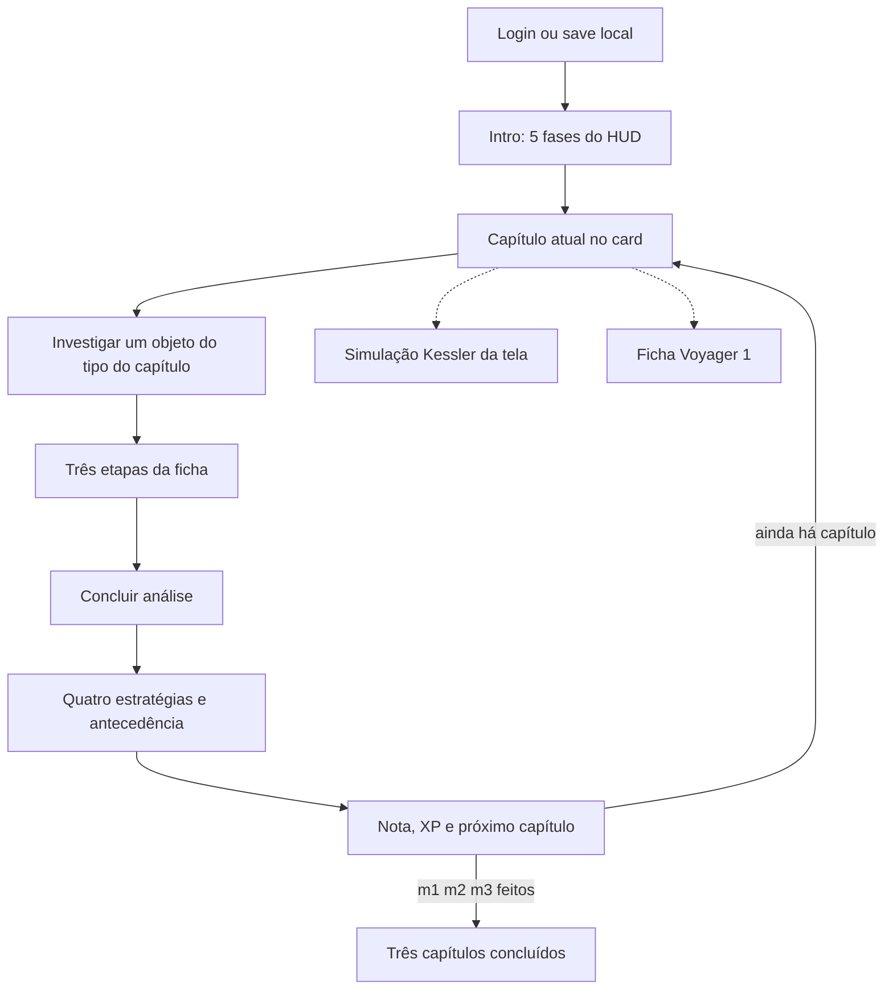
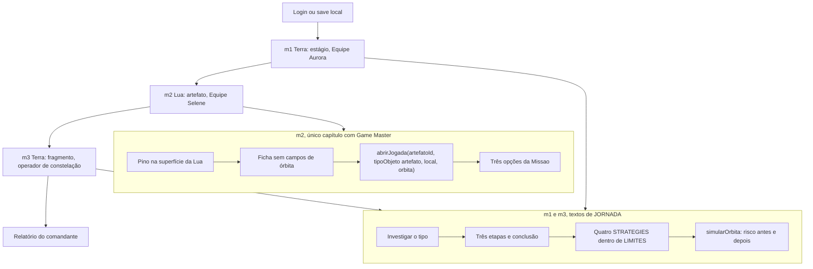

# Fluxo do jogador

Fase 0 do Atlas do Lixo Espacial, mais o que a jornada passou a fazer na tela. As seções 1 a 4 registram o diagnóstico. A seção 5 é a implementação.

Verificação de B em 14 nov 2026: `npm run verificar` (`tsc --noEmit`) passou. Não há suíte de testes em `data/`, `ia/`, `simulacao/` nem `app/` (nenhum `*.test.ts` / `*.spec.ts`). O único script de checagem fora do tipo é `node deep-space/checar.mjs`, e ele não cobre o módulo B.

## 1. Fluxo atual

O jogador vive em `Atlas do Lixo Espacial.html`. Os objetos orbitais vêm de `dados-objetos.js` (`window.DADOS_OBJETOS`). O catálogo lunar de `data/artifacts.ts` não entra nessa tela.

Capítulos gravados em `MISSIONS`:

| Id | Título na tela | Tipo | Textos |
|---|---|---|---|
| m1 | Estágio à deriva | `estagio` | briefing e explicação ainda dizem "a definir" |
| m2 | Satélite silencioso | `satelite` | idem |
| m3 | Nuvem de fragmentos | `fragmento` | idem |

A decisão usa `desvio`, `remocao`, `desorbitar` e `monitorar`. Isso não é o contrato do Game Master.

XP que a tela já dá: +10 na primeira investigação, +10 por etapa da análise, +20 ao concluir, +15 na primeira visita à Lua ou a Marte, +20 na primeira abertura da Voyager, e na decisão `50 + nota`. `XP_PER_LEVEL` é 150. O selo Catalogador exige os três tipos orbitais (`fragmento`, `satelite`, `estagio`), não um quarto tipo.

## 2. Fluxo alvo

Dois catálogos continuam separados. `DADOS_OBJETOS` segue sendo a fonte de F/S/E. `listarArtefatos()` segue sendo a fonte dos três sítios lunares. Não há mapa de F/S/E para o catálogo.

Cadeia da missão do m2, quando a implementação começar: ao vivo, se houver endpoint sem chave no navegador; senão `dados-missoes.json`; senão os textos estáticos de `JORNADA`. Sem `window.AtlasIA`, o jogo continua no fallback.

Marte fica fora dos capítulos até o esquema aceitar outro corpo. Hoje `CORPOS = ["lua"]`.

## 3. Estado `S`

`blank()` em `Atlas do Lixo Espacial.html`. O load faz `Object.assign(blank(), save)`, então um save antigo ganha o padrão dos campos que ainda não tinha. `save()` grava em `localStorage` (`atlas-lixo-espacial-v1`) ou chama `AP.salvarProgresso`.

| Campo | Tipo no save | Padrão | Papel |
|---|---|---|---|
| `started` | boolean | `false` | Intro já foi dispensada |
| `xp` | number | `0` | Experiência acumulada |
| `seen` | string[] | `[]` | Ids já investigados |
| `analyzed` | string[] | `[]` | Ids com análise concluída |
| `steps` | objeto id → string[] | `{}` | Etapas abertas por objeto (`origem`, `permanencia`, `riscos`) |
| `done` | objeto id → `{ strategy, score, lead }` | `{}` | Decisão de cada capítulo |
| `badges` | string[] | `[]` | Selos já dados |
| `path` | `{ kind, ref, label, t }[]` | `[]` | Diário |
| `kesslerMax` | number | `0` | Maior contagem vista na simulação da tela |
| `visited` | string[] | `['terra']` | Destinos já visitados |
| `dest` | string | `'terra'` | Destino salvo (`terra`, `lua`, `marte`) |
| `voyagerSeen` | boolean | `false` | Voyager já aberta |

`kind` do diário hoje: `obj`, `analise`, `viagem`, `missao`, `voyager`.

Não vão para `S`: objeto selecionado, etapa aberta na ficha, filtro do atlas, estratégia ainda não confirmada e o valor do slider antes da confirmação. Recarregar no meio da análise restaura `steps`, mas não qual painel estava aberto.

## 4. Relatório dos contratos

### a) Esquemas reais

`ContextoMissao` (`ia/esquema/contexto.ts`) só aceita estas chaves: `artefatoId`, `tipoObjeto`, `local`, `nivelRisco`. Campo a mais é recusado.

| Campo | Forma |
|---|---|
| `artefatoId` | `^[a-z0-9]+(?:-[a-z0-9]+)*$`, como `luna-2` |
| `tipoObjeto` | um valor de `TIPOS_OBJETO` |
| `local` | texto de 1 a 160 caracteres, sem espaço no começo nem no fim |
| `nivelRisco` | `baixo`, `moderado` ou `alto` |

`TIPOS_OBJETO`, depois do ajuste desta fase: `sonda_de_impacto`, `modulo_de_pouso`, `estagio_descartado`, `artefato`.

`Missao`: `artefatoId`, `titulo`, `briefing`, `opcoes` com exatamente três itens, na ordem preservar, medir, aproximar.

`OpcaoJogador`: `id` (`IDS_OPCAO`), `rotulo` (4 a 90 caracteres), `pesos`, `feedbackCientifico` (40 a 500 caracteres).

`Pesos`: `impacto`, `combustivel`, `seguranca`. Cada um é inteiro de 0 a 3 (`PESO_MAXIMO`). As três combinações são diferentes, e cada eixo varia entre as opções.

`IDS_OPCAO`: `preservar`, `medir`, `aproximar`.

`ParametrosSimulacao`: `objetosIniciais`, `lancamentosPorCiclo`, `remocaoAtivaPorCiclo`, `multiplicadorVelocidade`, `ciclos`. Outra chave é recusada.

`LIMITES` (a tela lê min, max e step daqui; não escreve a faixa à mão):

| Slider | Mínimo | Máximo | Passo |
|---|---|---|---|
| `lancamentosPorCiclo` | 0 | 60 | 1 |
| `remocaoAtivaPorCiclo` | 0 | 60 | 1 |
| `multiplicadorVelocidade` | 0,5 | 3 | 0,1 |
| `ciclos` | 1 | 100 | 1 |
| `objetosIniciais` | 0 | 50 000 | 1 |

Contagens são inteiros. A velocidade pode ser fracionária, desde que finita e dentro da faixa. O passo 0,1 só organiza o slider; a leitura aceita qualquer número finito na faixa.

Constantes do modelo em `simulacao/transicao.ts` (`MODELO`):

| Constante | Valor | Papel |
|---|---|---|
| `coeficienteColisao` | 1e-7 | taxa do encontro, proporcional a N × (N − 1) e à velocidade |
| `fragmentosPorColisao` | 6 | fragmentos rastreáveis criados por colisão; 2 objetos saem, saldo +4 |
| `objetosMaximos` | 250 000 | teto interno; estourar vira cascata |
| `limiarModerado` | 4 000 | objetos a partir daqui, ou 1 colisão, sobem de baixo para moderado |
| `limiarAlto` | 8 000 | objetos a partir daqui, ou 5 colisões, sobem para alto se a remoção cobre o saldo |
| `colisoesAltas` | 5 | colisões no ciclo que já contam como alto |

O ciclo é uma unidade abstrata do modelo, não um ano. A escala é didática: mostra o efeito das escolhas, não uma previsão de órbita real. `npm run testar` roda `simulacao/testar.ts` em cima desses contratos.

`RISCOS_ORBITAIS`: `baixo`, `moderado`, `alto`, `cascata`. `abrirJogada` lê o risco do último ciclo. `cascata` vira `alto` em `nivelRisco` da missão (`riscoParaMissao`). O risco orbital original continua em `dados.riscoOrbital`.

`abrirJogada` aceita só `artefatoId`, `tipoObjeto`, `local` e `orbita`.

Catálogo (`data/schemas/artifact.ts`): `id`, `cosparId`, `nomeOriginal`, `missao`, `corpo`, `dataUtc`, `operador`, `massaKg`, `referenciaMassa`, `coordenadas` (`latitudeGraus`, `longitudeLesteGraus`, `confianca`, `incertezaMetros`), `local`, `historico`, `statusAtual`. `CORPOS = ["lua"]`. Status: `fragmentado_no_impacto` ou `inativo_na_superficie`. Não há tipo nem fonte. Campo desconhecido dispara `CatalogoInvalidoError` na carga. Os registros saem congelados. `nomeOriginal` da Luna 2 traz cirílico.

Os três ids são `luna-2`, `luna-9` e `surveyor-1`. Nenhum F/S/E está nesse catálogo.

### b) Quem define os pesos

O modelo define os pesos quando a origem é `modelo`. O prompt manda inteiros de 0 a 3, combinações distintas e variação em cada eixo. `feedbackCientifico` é o texto de consequência daquela opção, e o esquema exige um texto por opção.

Se o modelo falta, estoura o tempo ou devolve JSON inválido, `missaoDeReserva` define os pesos no código, em `pesosDoRisco`, só a partir de `nivelRisco`. A reserva também preenche `feedbackCientifico` com frases tiradas do artefato. Não há idioma inglês nesse contrato: o prompt manda escrever em português.

### c) Provedor e o navegador

`ia/game-master/provedor.ts` chama um chat no formato da API da OpenAI. `POST` em `ATLAS_IA_URL` ou, na falta dela, `https://api.openai.com/v1/chat/completions`. O cabeçalho é `Authorization: Bearer` com `ATLAS_IA_CHAVE`, lida de `process.env`. Modelo padrão `gpt-4o-mini`. Tempo padrão 15 s. Sem chave, sem URL http(s) ou sem `fetch`, lança `ErroDeProvedor` e o serviço entrega a reserva.

Esse código não é seguro para o navegador se a chave viajar no pacote servido. A chave não está escrita no fonte hoje, mas o módulo não deve ser empacotado com `ATLAS_IA_CHAVE` embutida. A pré-geração e qualquer endpoint remoto ficam fora da página.

### d) Taxonomia

Não havia valor adequado para um artefato de superfície como classe única.

`sonda_de_impacto` descreve a Luna 2, não a Luna 9 nem a Surveyor 1. `modulo_de_pouso` descreve esses dois pousos, não a Luna 2. `estagio_descartado` é estágio, e a regra proíbe usar estágio ou satélite para sítio de superfície. O jogo também não tem `satelite` neste enum.

Decisão: `artefato` entrou em `TIPOS_OBJETO` e em `ROTULO_TIPO` ("artefato histórico"). O prompt ganhou uma frase: esse tipo já está na superfície e não é satélite nem estágio. A reserva não precisou de ramo novo, porque já lê `ROTULO_TIPO`. Não houve teste de B para ajustar. `npm run verificar` passou depois da mudança. O esquema do catálogo não foi alterado.

## 5. Jornada na tela

A página carrega `dist/atlas-ia.js` (IIFE, global `AtlasIA`) e só `js/atlas-adapter.js` fala com ele. Sem o bundle, a missão estática de `js/jornada.js` segue o capítulo. A chave não vai no pacote: o bundle só lê `globalThis.process.env.ATLAS_IA_CHAVE` em tempo de execução, e a página não cria `process`.

Capítulos: m1 Equipe Aurora, estágio na Terra, quatro estratégias. m2 Equipe Selene, "Herança na Lua", opções `preservar`, `medir`, `aproximar`. m3 operador de constelação, fragmento na Terra. Marte fica de fora até o catálogo aceitar outro corpo.

### Conversão dos pesos

Os pesos da missão são `impacto`, `combustivel` e `seguranca`, de 0 a 3. Os medidores da tela são `seg`, `comb`, `orc` e `ciencia`, de 0 a 100. Não são as mesmas chaves.

| Peso | Medidor |
|---|---|
| `impacto` | `ciencia = round(impacto / 3 * 100)` |
| `combustivel` (gasto) | `comb = round((3 - combustivel) / 3 * 100)` |
| `seguranca` | `seg = round(seguranca / 3 * 100)` |
| não existe no esquema | `orc = round((ciencia + comb + seg) / 3)` |

A nota continua 70% da média e 30% do pior medidor. A antecedência só entra nessa conta. Ela não muda a simulação: `remocaoAtivaPorCiclo` é o mesmo em todos os ciclos, e não há instante de início da ação.

Remoção da prática, calibrada e mantida: monitorar 0, desvio 0, desorbitar 15, remoção ativa 30. Sem remoção, m1 e m3 terminam em cascata. Com remoção 30, m1 termina em alto e m3 em moderado. O resultado mostra as duas séries no mesmo gráfico. O texto deixa claro que a decisão de uma missão não muda a população: a curva é o efeito da prática se todo mundo a adotasse, no modelo didático.

| Capítulo | Objetos iniciais | Lançamentos | Velocidade | Ciclos | Sem remoção | Com remoção 30 |
|---|---|---|---|---|---|---|
| m1 | 2 000 | 60 | 2 | 80 | cascata | alto |
| m3 | 2 000 | 40 | 1 | 60 | cascata | moderado |

Predefinições do modal, conferidas por `simular()`: órbita sob controle (2 000, 8, 12, 1, 40) fica em baixo; rumo à cascata (2 000, 40, 0, 2, 40) passa por baixo, moderado e termina em cascata; limpeza máxima (12 000, 0, 60, 1, 40) termina em alto.

O risco da Lua é do cenário didático do entorno, não da órbita do artefato. Três cenários cobrem as missões pré-geradas. `cascata` vira `alto` só na hora de buscar a missão.

| Artefato | Nível | Objetos | Lançamentos | Remoção | Velocidade | Ciclos |
|---|---|---|---|---|---|---|
| luna-2 | baixo | 180 | 1 | 2 | 1 | 24 |
| luna-9 | moderado | 4 500 | 2 | 8 | 1 | 24 |
| surveyor-1 | alto | 10 000 | 0 | 60 | 1 | 20 |

O rótulo na tela continua "Risco do entorno lunar (cenário didático)".

### De onde sai a missão da Lua

1. `window.GAME_MASTER_URL`, se existir, sem chave na página.
2. `dados-missoes.json`, uma entrada por artefato e por nível, em português.
3. `abrirJogada` no bundle, que cai na reserva se não houver chave.
4. Texto estático de `js/jornada.js`.

Em inglês a página usa o texto estático, porque o prompt do modelo é só em português. O badge "Gerada por IA" só aparece quando a origem é `modelo`. O arquivo gerado agora está com origem `reserva`.

`npm run pregerar` grava esse JSON e `js/artefatos-reserva.js`. Sem `ATLAS_IA_CHAVE` no ambiente, o script grava a reserva do catálogo. `npm run montar` gera `dist/atlas-ia.js`.

### O que não tem fonte na ficha

`Material Geral Lua.md` não traz linha de bibliografia nem URL. `FONTES_ARTEFATOS` fica vazio para `luna-2`, `luna-9` e `surveyor-1`. A ficha não mostra uma linha "Fonte". Os números continuam os do catálogo em `data/artifacts.ts`.

E-06, F-09 e F-10 saem do atlas e do contador (`COM_DADOS_APENAS`). O distintivo Catalogador continua só com fragmento, satélite e estágio.

### Onde a IA entra

A IA só escreve a missão da Lua, e só quando a origem marcada é o modelo. Os capítulos da Terra usam o simulador orbital e as fichas de `dados-objetos.js`. Sem o modelo, a Lua usa a missão padrão montada com o catálogo. O nome do jogador entra só na frase local `{jogador}` e não vai no pedido ao modelo.
